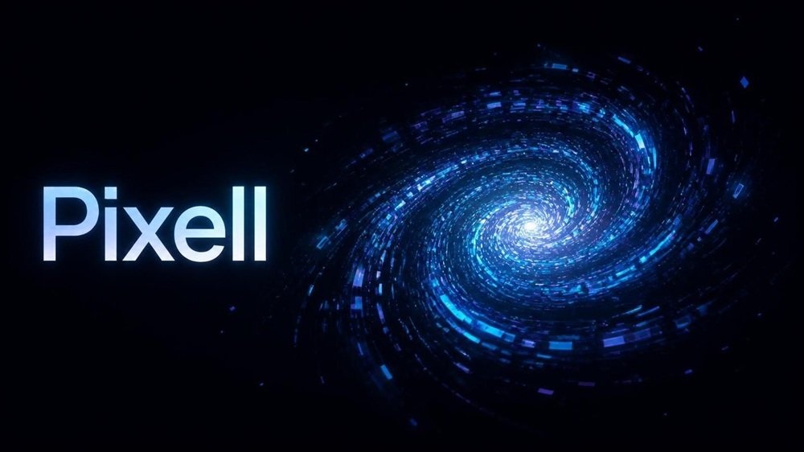

# Pixell

**Pixell** brings together the ideas of *cells* and *pixels*: small individual particles that come together to form animated shapes. It is an interactive particle playground and a standalone JavaScript animation engine built with the Canvas 2D API. Particles morph between two shapes, react to pointer movement, and can be configured while the animation is running.



## Features

- Morph between geometric shapes, a spiral galaxy, text, and line-art portraits (including a human face and a cat face).
- Choose from playground presets or adjust particle count, motion, colors, glow, trails, pointer effects, and morph behavior.
- Export the current frame as PNG, copy modified settings as JSON, copy an embed snippet, or share a configuration URL.
- Use `galaxy.js` independently of the playground. No build step or JavaScript package installation is required.

## Run locally

1. Download or clone the repository.
2. Open `index.html` directly in a browser, or run a local server from the project directory:

   ```sh
   python -m http.server 8080
   ```

3. Visit <http://localhost:8080/index.html>. On Windows, `serve.cmd` runs the same Python server and opens the playground (Python must be installed and available on PATH).

Try a preset, change the **A** and **B** shapes, and choose a trigger (hover, click, auto, manual, always, or never). `docs.html` contains detailed Persian explanations and live demos; `example.html` shows smaller integrations.

## Use in your own page

Copy `galaxy.js` into your site and load it before the script that initializes the canvas. Give the canvas a CSS width and height; the engine scales its drawing buffer to its displayed size.

```html
<canvas id="particles" style="display:block;width:320px;height:320px"></canvas>
<script src="galaxy.js"></script>
<script>
  const canvas = document.getElementById("particles");
  const galaxy = PixcelGalaxy(canvas, {
    n: 900,
    from: "disc",
    to: "sphere",
    trigger: "auto",
    autoPeriod: 4,
    palette: "aurora"
  });

  // Keep the returned instance to update it or stop it later.
</script>
```

`PixcelGalaxy(canvas, options)` accepts a real `<canvas>` element and an optional options object. Defaults are exposed as `PixcelGalaxy.defaults`. The default setup morphs from `disc` to `galaxy` on hover with 380 particles.

### Faces, text, and shapes

```js
// Built-in line art; no image files or network requests are required.
galaxy.set({ to: "image", shape: "cat-face-front", trigger: "always" });

// Other image shape values: "human-face-front", "skull-front", "eye", "smiley".
galaxy.set({ to: "text", text: "Hello", trigger: "auto", n: 1200 });
```

Shape names available for `from` and `to`:

| Category | Values |
| --- | --- |
| Original and classic | `disc`, `galaxy`, `ring`, `sphere`, `heart`, `star`, `grid`, `helix`, `text` |
| Geometry and patterns | `triangle`, `square`, `hexagon`, `cube`, `pyramid`, `torus`, `spiral`, `flower`, `mandala`, `infinity`, `butterfly`, `atom`, `crescent`, `wave` |
| Canvas-drawn portrait | `image` (choose the drawing with `shape`) |

When either side is `image`, the `shape` option selects its portrait. If both sides are `image`, they use the same `shape` setting.

## Common options

Pass these to `PixcelGalaxy(canvas, options)` or update them later using `galaxy.set({ ... })`:

| Option | Default | Description |
| --- | --- | --- |
| `n` | `380` | Number of particles. More particles require more CPU time. |
| `from`, `to` | `"disc"`, `"galaxy"` | Starting and target shapes. |
| `trigger` | `"hover"` | Morph on `hover`, `click`, `auto`, `manual`, `always`, or `never`. |
| `manual` | `0` | Morph amount from 0 (A) to 1 (B) when `trigger` is `"manual"`. |
| `autoPeriod` | `4` | Seconds spent in each state when using `"auto"`. |
| `palette` | `"codebeats"` | `"codebeats"`, `"nebula"`, `"fire"`, `"aurora"`, `"rainbow"`, `"mono"`, or an array of hex colors. |
| `mouse` | `"repel"` | Pointer interaction: `"repel"`, `"attract"`, `"swirl"`, or `"off"`. |
| `radius` | `0.44` | Shape radius as a fraction of the smaller canvas dimension. |
| `trail`, `glow` | `0`, `true` | Motion-trail strength and central glow toggle. |
| `text`, `textFont` | `"PIXCEL"`, system font | Content and font when using the `text` shape. |
| `shape` | `"human-face-front"` | Portrait drawing when using the `image` shape. |
| `petals` | `6` | Petal count for the `flower` shape. |
| `host` | `null` | Optional element for pointer events instead of the canvas; set it when creating the instance. |

Other controls, including `ease`, `follow`, `order`, `stagger`, `speed`, `colorMode`, and `clickShock`, are defined in `PixcelGalaxy.defaults` in `galaxy.js` and exposed in the playground. The playground's background color (`bg`) is a UI-only setting, not an engine option; set your page's background with CSS.

## JavaScript API

```js
galaxy.set({ to: "cube", trigger: "click" }); // Update options in place.
console.log(galaxy.options());                 // Current options (excluding host).
console.log(galaxy.state());                   // { mix, spd, rot, fps, n }.
galaxy.toggle();                               // Toggle the click-triggered target.
galaxy.shock();                                // Shock wave from the canvas center.
galaxy.shock(100, 100);                        // Or use canvas CSS-pixel coordinates.
galaxy.scramble();                             // Scatter particles before they settle again.
galaxy.destroy();                              // Stop animation and remove listeners.
```

Call `destroy()` when disposing of a canvas in a dynamic page. Each instance has its own particle list and animation loop. `PixcelGalaxy.shapes`, `PixcelGalaxy.palettes`, and `PixcelGalaxy.defaults` are also exposed on the global constructor.

### Add your own shape

Register the shape after loading `galaxy.js` and before creating the instance. A shape receives a particle (`p`), current rotation (`rot`), options (`o`), and a reusable output object (`out`). Set `out.x`, `out.y`, and `out.z` every call; coordinates are approximately in the range -1 to 1, and `z: 0` makes a flat shape.

```js
PixcelGalaxy.shapes.diamond = (p, rot, o, out) => {
  const angle = p.u * Math.PI * 2;
  const scale = p.r2 < 0.7 ? 1 : Math.sqrt(p.r3);
  out.x = Math.cos(angle + rot * 0.3) * scale * 0.8;
  out.y = Math.sin(angle + rot * 0.3) * scale;
  out.z = 0;
};

const galaxy = PixcelGalaxy(document.getElementById("particles"), {
  to: "diamond",
  trigger: "auto"
});
```

Custom shapes work directly with the engine. To also show one in the playground dropdowns, add its label to `SHAPES` in `playground.js` and load its registration script after `galaxy.js` but before `playground.js`.

## How it works

The engine gives every particle stable random values, then calculates its coordinates in shapes A and B on each animation frame. It interpolates between those positions using the current morph amount, applies pointer and shock effects, and draws the result on a 2D canvas. `requestAnimationFrame` drives the animation; rendering is skipped while the document is hidden or the canvas is off-screen. Pixel density is capped at 2 to limit canvas memory usage.

## Project structure

| Path | Purpose |
| --- | --- |
| `index.html` | Interactive playground and export actions. |
| `playground.js` | Playground controls, presets, URL/localStorage settings. |
| `galaxy.js` | Standalone particle engine and built-in shapes. |
| `style.css` | Playground and documentation styles. |
| `example.html` | Minimal integrations. |
| `docs.html` | Detailed Persian documentation with demos. |
| `original/` | Original reference files, preserved for comparison. |
| `serve.cmd` | Windows convenience script for the Python HTTP server. |

The `original/` directory is a reference copy of the earlier `fxGalaxy` implementation from the CodeBeats project. The standalone engine adds configuration and shapes without changing those reference files.

## Publish as a static site

This is a static project: upload the HTML, CSS, and JavaScript files together, keeping the same relative paths. For GitHub Pages, configure Pages to publish from the repository root and open the resulting `index.html`. The playground's shareable URLs use the URL hash and do not require a backend.

Before publishing, add a real screenshot at `assets/preview.png` (or change the image path at the top of this README). No image or license file is currently included; add a license only if you intend to specify reuse terms.

